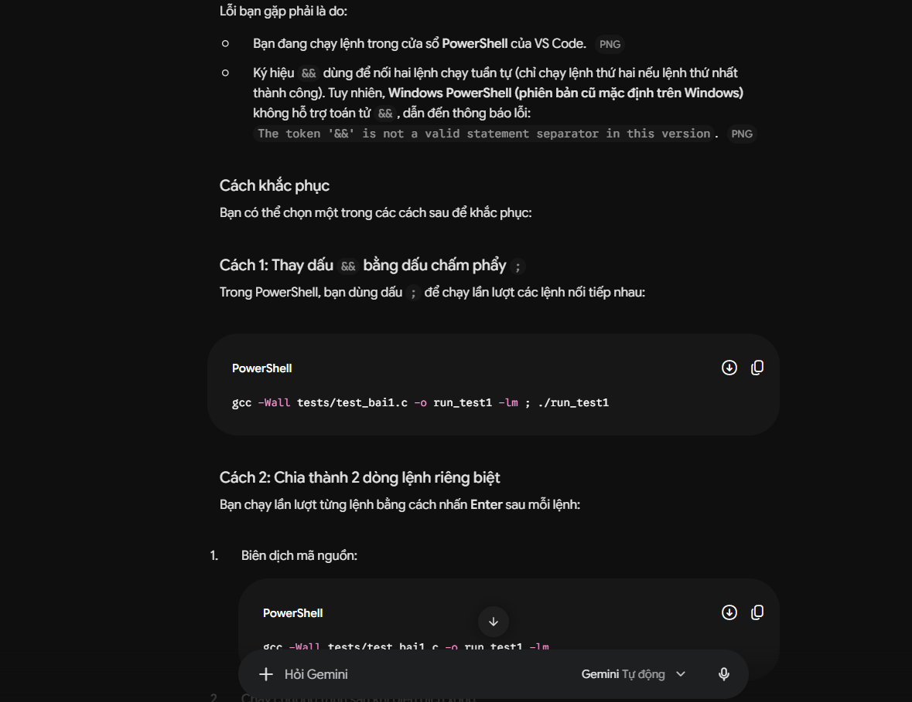

# NHẬT KÝ THỰC HIỆN LAB 6 (LOGBOOK)

* **Họ và tên: Nguyễn Hoàng Cương** 
* **Mã sinh viên: PS51895** 
* **Link Repository cá nhân: https://github.com/natsumijaki83-collab/COM108-Lab6-PS51895..git** 

> [!NOTE]
> **HƯỚNG DẪN DÀNH CHO KỶ NGUYÊN AI:**  
> Bạn được khuyến khích sử dụng AI (Cursor, Copilot, ChatGPT, Claude) như một trợ lý lập trình. Tuy nhiên, AI thường xuyên sinh mã lỗi đối với các trường hợp biên (biên mảng, số âm, tràn chỉ số). Hãy ghi lại trung thực quá trình bạn phát hiện và khắc phục lỗi của AI.

---

### Lần 1: Bài 1 - Bộ Lọc Làm Mịn Tín Hiệu (Moving Average)
- Trạng thái: Failed
- Prompt hỏi AI (nếu có): giải thích và fix lỗi 
- Lỗi phát hiện qua Test (nếu có): 
- Cách sửa / Bài học: thay "&&" thành ";" do && ko phù hợp với phiên bản Vscode

### Lần 2: Bài 1
- Trạng thái: chờ chấm
- Lỗi / Cách sửa: 100% pass

### Lần 3: Bài 1 (Dự phòng)
- Trạng thái: 
- Lỗi / Cách sửa: 

---

### Lần 4: Bài 2 - Nén Sai Phân Dữ Liệu IoT (Delta Encoding)
- Trạng thái:failed
- Prompt hỏi AI (nếu có): 
- Lỗi phát hiện qua Test (nếu có):tại vòng lập "for" giainen thiếu dấu "+" trong phương thức "i++" và ; ở dưới vòng lập
- Cách sửa / Bài học: thêm ";", "+" vào vòng lập "for" tại chổ còn thiếu

### Lần 5: Bài 2
- Trạng thái: Chờ chấm
- Lỗi / Cách sửa: 100% pass

### Lần 6: Bài 2 (Dự phòng)
- Trạng thái: 
- Lỗi / Cách sửa: 

---

### Lần 7: Bài 3 - Bộ Lọc Làm Mờ Điểm Ảnh (Box Blur Filter 3x3)
- Trạng thái: Failed
- Prompt hỏi AI (nếu có): tại sao lại sai 
- Lỗi phát hiện qua Test (nếu có): thiếu phép chia ở cưới hàm
- Cách sửa / Bài học: thêm phép chia nguyên vào cuối hàm

### Lần 8: Bài 3
- Trạng thái: Chờ chấm
- Lỗi / Cách sửa: 

### Lần 9: Bài 3 (Dự phòng)
- Trạng thái: 
- Lỗi / Cách sửa: 

---

### Lần 10: Bài 4 - Radar Dò Điểm Nóng (Thermal Peak Detection)
- Trạng thái: 
- Prompt hỏi AI (nếu có): 
- Lỗi phát hiện qua Test (nếu có): 
- Cách sửa / Bài học: 

### Lần 11: Bài 4
- Trạng thái: 
- Lỗi / Cách sửa: 

### Lần 12: Bài 4
- Trạng thái: 
- Lỗi / Cách sửa: 

### Lần 13: Bài 4 (Dự phòng)
- Trạng thái: 
- Lỗi / Cách sửa: 
